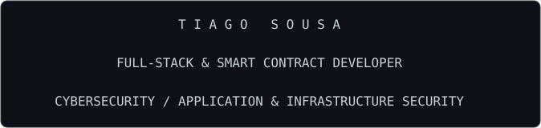
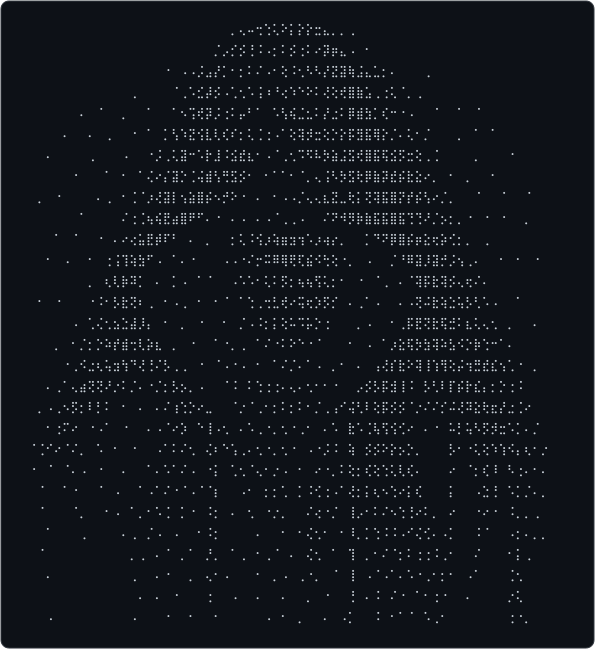
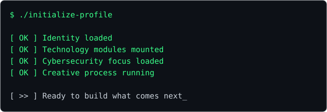
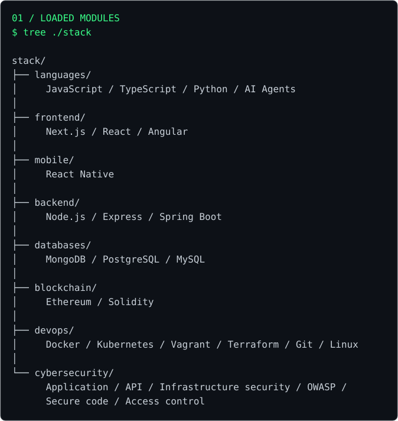
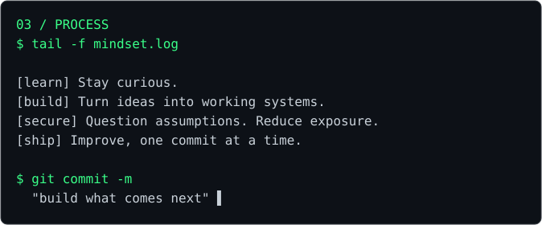

<!-- Upload README.md and the assets/ folder together. -->

<picture>

  <source media="(max-width: 600px)" srcset="./assets/header-mobile.svg" />

  

</picture>

  

  

<picture>

  <source media="(max-width: 600px)" srcset="./assets/boot-mobile.svg" />

  

</picture>

  

<picture>

  <source media="(max-width: 600px)" srcset="./assets/modules-mobile.svg" />

  

</picture>

02 / CONNECTIONS

↗ PORTFOLIO — Explore my work

↗ LINKEDIN — Connect with me

<picture>

  <source media="(max-width: 600px)" srcset="./assets/process-mobile.svg" />

  

</picture>

  

<picture>

  <source media="(max-width: 600px)" srcset="https://readme-typing-svg.demolab.com/?font=Fira+Code&amp;size=15&amp;duration=3200&amp;pause=1300&amp;color=39FF88&amp;background=0D1117&amp;center=true&amp;vCenter=true&amp;width=360&amp;height=65&amp;lines=%3E+initializing...%3B%3E+web+%2F+mobile+%2F+on-chain%3B%3E+AI+agents+%2F+security%3B%3E+tiagosousa10%3A~%24+ready_" />

  

</picture>

GITHUB TELEMETRY

  

